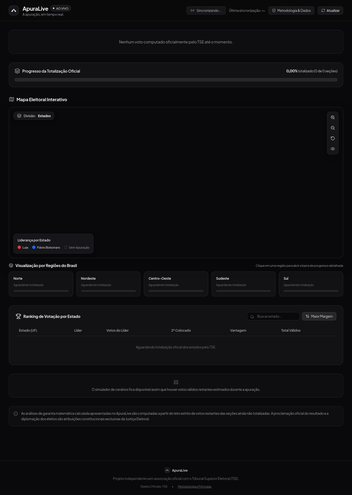

# ApuraLive — A apuração, em tempo real.

<div align="center">

[](https://apura-live.vercel.app/)
[](https://apuralive.onrender.com/health)
[](LICENSE)

### 🌐 [https://apura-live.vercel.app/](https://apura-live.vercel.app/)
**Acompanhamento independente e em tempo real da apuração presidencial com dados oficiais do Tribunal Superior Eleitoral (TSE).**

---

<p align="center">
  
</p>

</div>

---

> [!IMPORTANT]
> **Aviso Editorial e Legal (Projeto Independente):**
> O **ApuraLive** é uma plataforma jornalística e tecnológica independente, sem qualquer afiliação institucional, patrocínio ou vínculo com o Tribunal Superior Eleitoral (TSE) ou partidos políticos. Os dados são obtidos diretamente das fontes públicas oficiais da Justiça Eleitoral. A proclamação e homologação dos resultados são atribuições exclusivas do TSE.

---

## ⚡ Todas as Features da Plataforma

| Categoria | Feature | Descrição Detalhada |
| :--- | :--- | :--- |
| **Placar Nacional** | **Dados ao Vivo da CDN TSE** | Consulta direta aos arquivos oficiais EA14 e EA20 da eleição presidencial. |
| **Placar Nacional** | **Fotos & Identificação Visual** | Cores oficiais dos candidatos (**Vermelho `#E53935` para Lula** e **Azul `#2563EB` para Flávio Bolsonaro**) com enquadramento de fotos aperfeiçoado (`object-top`). |
| **Placar Nacional** | **Contagem e Percentuais Nominais** | Votos válidos, brancos, nulos, abstenções e seções totalizadas atualizados em tempo real. |
| **Placar Nacional** | **Diferença Dinâmica** | Cálculo instantâneo da margem de liderança em votos absolutos e percentuais. |
| **Análise Matemática** | **Irreversibilidade Amigável** | Cálculo objetivo focado no líder: exibe exatamente quantos votos faltam para garantir a vitória matemática. |
| **Análise Matemática** | **Teto Estrito Conservador ($R$)** | Considera o limite superior de votos ainda possíveis nas urnas pendentes para garantir 100% de precisão. |
| **Mapa Interativo** | **Visão Multinível por Zoom** | Transição automática entre visualização por **Estados (UFs)** e por **Municípios (5.564 cidades)** ao atingir o limiar de zoom (`zoom >= 5.8`). |
| **Mapa Interativo** | **Cor Sólida por Estado** | No nível geral, os estados são pintados com a cor 100% intensa do líder local. |
| **Mapa Interativo** | **Escala Divergente Tricolor (`Vermelho <-> Cinza <-> Azul`)** | No nível municipal, a intensidade da cor varia gradualmente conforme a vantagem percentual sobre o concorrente (com cinza neutro em caso de empate/50%). |
| **Mapa Interativo** | **Zero Flicker & Câmera Preservada** | A atualização em segundo plano não recria o canvas nem reseta a posição, o zoom ou o pan do usuário. |
| **Mapa Interativo** | **Carregamento Otimizado por Viewport** | Download dinâmico dos dados municipais apenas das UFs visíveis na tela, garantindo alta fluidez. |
| **Mapa Interativo** | **Popups e Modais Detalhados** | Tooltip ao passar o mouse e modal completo ao clicar sobre qualquer estado ou cidade com fotos, progresso de urnas e votação nominal. |
| **Mapa Interativo** | **Controles de Navegação** | Botões flutuantes para zoom in, zoom out, reset para a visualização do Brasil inteiro e alternância de alto contraste. |
| **Regiões & Urnas** | **Acompanhamento Regional** | Totalização agregada para as 5 macrorregiões do país (*Norte, Nordeste, Centro-Oeste, Sudeste e Sul*). |
| **Regiões & Urnas** | **Sidebar de Progresso das Urnas** | Exibe a barra de progresso visual comparando seções apuradas versus seções faltantes por região. |
| **Tabelas & Filtros** | **Rankings Estaduais Interativos** | Classificação instantânea por maior margem percentual ou maior volume absoluto de votos, com busca por nome de estado ou sigla (UF). |
| **Simulador** | **Cenários Hipotéticos** | Distribuição interativa dos votos válidos restantes via slider, simulando projeções finais de placar com badge explícito de simulação não-oficial. |
| **Exportação** | **Exportação JSON e CSV** | Download dos dados consolidados em formatos estruturados para auditoria ou análises externas. |
| **Exportação** | **Cópia para Redes Sociais** | Botão de compartilhamento rápido com resumo textual pronto para publicação. |
| **Transparência** | **Modal de Metodologia e Auditoria** | Explicação jurídica da isenção editorial, detalhamento das fórmulas matemáticas e links diretos para a documentação técnica oficial do TSE. |
| **Design & Branding** | **Nova Logo em Vetor** | Vetor geométrico chevron aplicado em todo o ecossistema: Favicon, Cabeçalho e Rodapé. |
| **Design & Branding** | **Dark Mode Imparcial** | Paleta sofisticada baseada em tons neutros de zinco (`#09090b` / `#18181b`) que garante total neutralidade jornalística. |

---

## 🏛️ Arquitetura Técnica (Zero Banco de Dados)

```
                    ┌───────────────────────────────┐
                    │  CDN Oficial do TSE           │
                    │  (Arquivos EA14, EA20 JSON)   │
                    └───────────────▲───────────────┘
                                    │ HTTPX (Cache + ETag 304 + Single-Flight)
                    ┌───────────────┴───────────────┐
                    │  Backend FastAPI (Python)     │
                    │  Deploy: Render Web Service   │
                    │  https://apuralive.onrender.com│
                    └───────────────▲───────────────┘
                                    │ REST / CORS Universal
                    ┌───────────────┴───────────────┐
                    │  Frontend SPA (React 19 + TS) │
                    │  Deploy: Vercel               │
                    │  https://apura-live.vercel.app│
                    └───────────────────────────────┘
```

- **Resiliência contra Quedas**: Cache inteligente com single-flight (`asyncio.Lock`). Se centenas de usuários acessarem a API simultaneamente, apenas 1 consulta externa ao TSE é executada.
- **Suporte a 304 Not Modified**: O cliente preserva os últimos dados válidos quando a fonte retorna 304, eliminando oscilações e respostas vazias na interface.

---

## 🚀 Como Executar Localmente

### Pré-requisitos
- **Node.js** 20+
- **Python** 3.11+

### 1. Clonar o Repositório
```bash
git clone https://github.com/WeslleySantiagoo/ApuraLive.git
cd ApuraLive
```

### 2. Backend (FastAPI)
```bash
cd backend
python3 -m venv .venv
source .venv/bin/activate
pip install -r requirements.txt

# Iniciar servidor FastAPI na porta 8000
uvicorn app.main:app --reload --port 8000
```
- Swagger UI: [http://localhost:8000/docs](http://localhost:8000/docs)
- Health Check: [http://localhost:8000/health](http://localhost:8000/health)

### 3. Frontend (Vite + React)
```bash
cd frontend
npm install

# Iniciar em modo de desenvolvimento na porta 5173
npm run dev
```
Acesse [http://localhost:5173](http://localhost:5173).

### 4. Executar os Testes Automatizados
```bash
# Testes do Backend (pytest)
PYTHONPATH=backend ./backend/.venv/bin/pytest backend/tests -v

# Build de Produção do Frontend
cd frontend && npm run build
```

---

## 📄 Licença

Este projeto é disponibilizado sob a licença [MIT](LICENSE).
